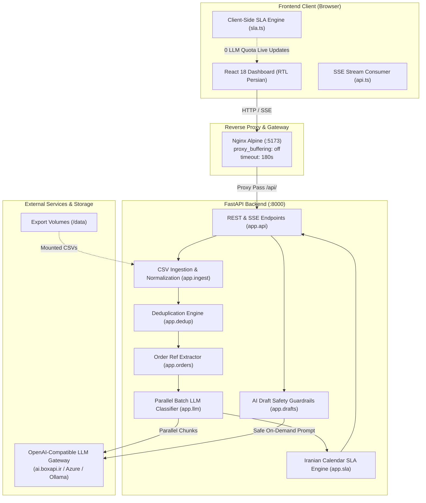

# System Architecture Overview

Bazarcheh Support Triage Dashboard is an end-to-end operational platform designed to help the support lead (Sara) triage, prioritize, and answer incoming customer messages across email, app, Telegram, and Instagram channels.

---

## 1. High-Level Architecture

---

## 2. Core Subsystems

| Subsystem | Tech Stack | Role & Responsibility |
|---|---|---|
| **Frontend** | React 18, TypeScript, Vite | Persian/RTL user interface, live countdown timers, upload form with streaming progress widget, tabbed filtering for attention messages, and draft approval. |
| **Reverse Proxy** | Nginx Alpine | Serves compiled SPA assets, proxies `/api/` traffic to the backend, disables buffering for Server-Sent Events, and enforces 180s timeout bounds. |
| **Backend API** | FastAPI, Uvicorn, Python 3.12 | Handles batch file ingestion, duplicate detection, parallel LLM categorization, SLA calculation, and safety validation for AI drafts. |
| **Batch CLI** | Python 3.12, Pandas | Nightly batch processing command (`python -m app.cli analyze`) producing deterministic JSON reports for downstream systems. |
| **AI Classifier** | OpenAI-compatible API | Classifies customer messages across 6 categories (`delivery`, `payment`, `refund`, `product_quality`, `account`, `other`) with automatic fallback to keyword heuristics. |

---

## 3. End-to-End Data Flow

1. **Upload & Ingest:** The user uploads a support export CSV file (`messages_sample.csv` or `eval_messages.csv`) via the browser.
2. **Streaming Event Emitter:** If requested with `stream=true`, the backend initiates a Server-Sent Events (`text/event-stream`) session emitting progress updates from 10% to 100%.
3. **Deduplication:** Repeated inquiries sent by the same customer with identical subject and body text are linked to their canonical first occurrence (`duplicate_of`).
4. **Order Reference Extraction:** Mentions of order codes (`BZ-...`) using either ASCII digits (`0-9`), Persian digits (`۰-۹`), or Arabic digits (`٠-٩`) are normalized to standard uppercase ASCII identifiers.
5. **Parallel AI Classification:** Canonical messages are partitioned into batches of 20 and classified concurrently across 6 worker threads, reducing processing time from >138s to ~35s.
6. **SLA Calculation:** Working hours between message receipt and reference evaluation time are computed according to the Iranian Saturday–Wednesday (09:00–17:00) business schedule and 26 official public holidays of year 1405.
7. **Triage Presentation:** Urgent messages (`business_minutes_left <= 0`) and near-deadline messages (`business_minutes_left > 0`) are displayed in the Attention List sorted by urgency.
