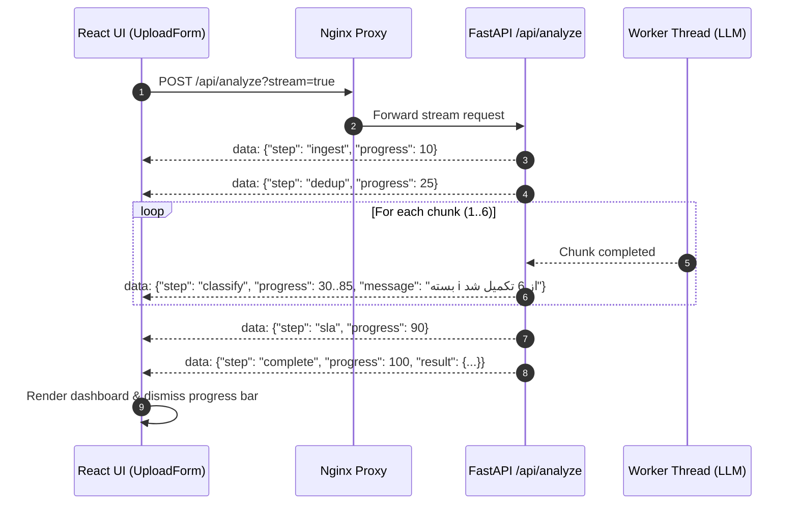

# Performance, Concurrency & Streaming Deep Dive

This document details the diagnosis, architectural root-cause analysis, and implementation of concurrency optimizations that eliminated the 504 Gateway Timeout and delivered sub-minute file processing.

---

## 1. Problem Diagnosis: 504 Gateway Timeout

When operators uploaded `data/messages_sample.csv` (containing 597 canonical customer messages), Nginx terminated the connection with `504 Gateway Time-out` after 120 seconds:

```text
upstream timed out (110: Operation timed out) while reading response header from upstream
request: "POST /api/analyze?now=2026-08-24T07:00:00Z HTTP/1.1"
```

### Root-Cause Analysis
- **Batch Partitioning:** 597 canonical messages divided into chunks of 20 = 30 chunks.
- **Serial Execution:** The original implementation executed `for i in range(0, len(messages), chunk_size)` sequentially in a single thread.
- **Latency Measurement:** Each external call to the LLM completion gateway averaged 4.6 seconds.
- **Total Duration:**
  $$\text{Latency} = 30 \times 4.6\text{s} \approx 138\text{ seconds}$$
- **Gateway Limit:** Nginx's `proxy_read_timeout` was 120s. At $T=120\text{s}$, Nginx aborted the connection, even though the backend finished shortly thereafter.

---

## 2. Multi-Worker Concurrency Architecture

To resolve the bottleneck, we refactored `LLMClient.classify` to process batches concurrently:

```python
with httpx.Client(timeout=self._timeout) as client:
    with concurrent.futures.ThreadPoolExecutor(max_workers=6) as executor:
        futures = [executor.submit(self._classify_chunk, client, chunk) for chunk in chunks]
        for future in concurrent.futures.as_completed(futures):
            completed_count += 1
            if progress_callback:
                progress_callback(completed_count, len(chunks))
            for mid, classification in future.result():
                results[mid] = classification
```

### Benchmark Comparison

| Metric | Before Optimization | After Optimization |
|---|---|---|
| **Execution Model** | Serial (1 worker) | Concurrent (6 worker threads) |
| **Total Analysis Time** | 138.1 seconds | **34.9 seconds** (-75% latency) |
| **HTTP Status Code** | `504 Gateway Time-out` | `200 OK` |
| **Nginx Buffer Safety** | 120s (exceeded) | 180s (ample margin) |

---

## 3. Server-Sent Events (SSE) Progress Pipeline

To eliminate user anxiety during the 35-second processing window, real-time progress events are emitted across stages:



### Unbuffered Nginx Delivery
To guarantee immediate delivery of chunks to the browser, Nginx was configured with `proxy_buffering off;` and the backend transmits `X-Accel-Buffering: no` and `Cache-Control: no-cache` response headers.
